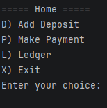
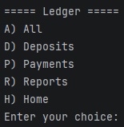
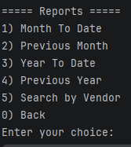

````mermaid
flowchart TD
A1[Main] --> B[runHomeScreen]
B --> C1[D.Add Deposit/addDeposit]
B --> C2[P.Make Payment/makePayment]
B --> C3[L.Ledger/runLedgerScreen]
B --> C4[X.Exit]
C3 --> D1[A.All/printAllTransactions]
C3 --> D2[D.Deposits/printDeposits]
C3 --> D3[P.Payments/printPayments]
C3 --> D4[R.Reports/runReportsScreen]
C3 --> D5[H.Home]
D4 --> E1[1.Month To Date/runMonthToDate]
D4 --> E2[2.Previous Month/runPreviousMonth]
D4 --> E3[3.Year to Date/runYearToDate]
D4 --> E4[4.Previous Year/runPreviousYear]
D4 --> E5[5.Search by Vendor/searchByVendor]
D4 --> E6[6.Back]
````
# App Function
The App created functions as a ledger to record transactions based on date, time, description, vendor, and amount. The App can record both payments and deposits into the account and allows for filtering to search specific transactions based on the previously mentioned parameters. 

# App Experience

## Home Screen
The app will open up straight into the Home Screen which displays four options for the user to interact with. The first one being Add Deposit which will allow the user to input a new deposit with the parameters mentioned before. The second option is named Make Payment, which allows the user to input purchases. A Ledger option which allows the user to open up a sub-menu into the Ledger menu which will allow users to see transactions. Finally, the Exit option will allow users to close down the app.

### Home Screen


## Ledger Screen
The Ledger Screen displays five options for the user to interact with. The first option is All which will allow the user to see all transactions in the ledger. The second option is Deposits, which will allow the user to see only deposits that have been made. The third option is Payments, which will allow hte user to see all payments that have been made. The Reports option will lead the user into the Reports Screen which will allow users to search transactions based on criteria such as certain dates and vendors. The final option, Home, allows users to return to the Home Screen.

### Ledger Screen


## Reports Screen
The Reports Screen displays six options for the user to interact with. The first two options allow for users to pull up transactions based on the current month and the previous month, only pulling transactions from the specified month. The next two options allow the user to pull transactions from either the current year or the previous year. The fifth option allows users to search transactions based off specific vendors. The final option, Back, allows users to return to the Ledger Screen.

### Reports Screen


## Interesting code
The most interesting piece of code I made was this one, due to how simple it looks despite the hours of code needed just to make it look simple

    public static void displayYearToDate() {
    System.out.println("\n===== Year To Date =====");
    int currentYear = LocalDate.now().getYear();

        ArrayList<Transaction> filtered = getTransactionsByYear(currentYear);

        printTransactionTable(filtered);
        pressEnterToContinue();
    }

It took three method to create this one, I will not provide the other codes for simplicities stake, but this code was was the most interesting due to how compact it looks due to all the work of the methods in the background, or "helper" methods.